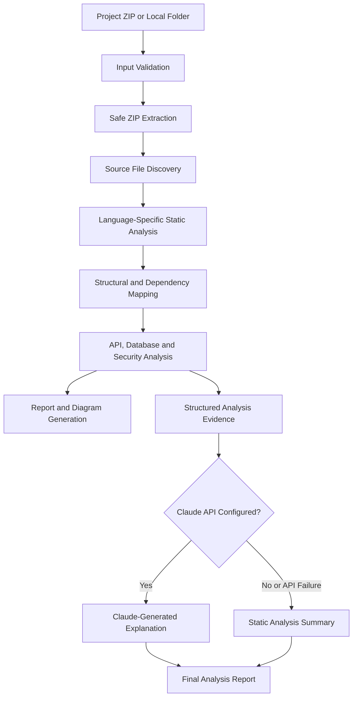

# CODEX — Software Reverse Engineering & Application Intelligence

> **Understand an unfamiliar codebase faster.** CODEX performs evidence-based static analysis on an existing software project and turns the findings into structured technical documentation.

CODEX is a Python-based project-analysis tool developed as a PS06 prototype. It helps developers explore an authorised codebase by identifying its structure, technologies, APIs, data models, dependencies and potential security concerns—without executing the uploaded source code.

---

## Table of Contents

- [Overview](#overview)
- [Key Features](#key-features)
- [How It Works](#how-it-works)
- [Supported Languages and Detection](#supported-languages-and-detection)
- [Technology Stack](#technology-stack)
- [Getting Started](#getting-started)
- [Using the Web Interface](#using-the-web-interface)
- [Command-Line Usage](#command-line-usage)
- [Claude AI Integration](#claude-ai-integration)
- [Generated Outputs](#generated-outputs)
- [Project Structure](#project-structure)
- [Security and Privacy](#security-and-privacy)
- [Known Limitations](#known-limitations)
- [Running Tests](#running-tests)
- [Demo Application](#demo-application)
- [Roadmap](#roadmap)

---

## Overview

Understanding an existing software project can require significant time, especially when documentation is incomplete or the original developers are unavailable. Developers may need to manually trace imports, identify application components, locate API routes, understand database structures and determine how modules relate to one another.

CODEX streamlines this initial investigation through static source-code analysis. It extracts technical evidence from a project and generates readable reports and diagrams. An optional Claude AI integration uses the extracted evidence to provide a concise application overview and improvement suggestions.

### Design Goals

- Reduce the effort required to understand unfamiliar codebases.
- Present code structure and relationships in a single report.
- Generate useful technical documentation from source files.
- Keep the core analysis functional without an AI provider.
- Analyse uploaded source code without running it.

---

## Key Features

| Feature | Description |
|---|---|
| **Codebase import** | Upload an authorised ZIP archive through the web interface or analyse a local folder/archive. |
| **Multi-language discovery** | Recognises Python, Java, JavaScript, TypeScript and SQL source files. |
| **Structural analysis** | Extracts supported imports, classes, functions, methods and route declarations. |
| **API exploration** | Detects supported Flask, Express and Spring-style endpoint declarations. |
| **Database exploration** | Identifies basic SQL table definitions, columns, foreign-key references and recognised SQLAlchemy model fields. |
| **Dependency mapping** | Resolves supported cross-file imports and builds an approximate dependency graph. |
| **Call relationship analysis** | Uses detected function names to construct a best-effort call graph. |
| **Security pattern checks** | Flags selected suspicious source-code patterns for further review. |
| **Architecture visualisation** | Generates Mermaid diagrams for architecture, database relationships and call relationships where evidence is available. |
| **Technical documentation** | Produces HTML and Markdown reports, API documentation and suggested test cases. |
| **Optional AI insights** | Uses Claude to explain the extracted static-analysis evidence and suggest improvements. |
| **AI fallback** | Continues to provide a deterministic static-analysis summary when Claude is not configured or unavailable. |

---

## How It Works



1. **Input:** The user uploads an authorised ZIP file or provides a local project path.
2. **Validation:** CODEX checks archive paths, symbolic links, file counts and extraction-size limits before extracting an archive.
3. **Discovery:** Supported source files are identified while common generated and dependency directories are ignored.
4. **Static analysis:** Language-specific routines extract supported code structures and technical evidence.
5. **Relationship mapping:** CODEX resolves supported imports and builds approximate dependency and function-call relationships.
6. **Insight generation:** The extracted evidence is used to create reports. If configured, Claude generates an additional explanation; otherwise, CODEX uses its static-analysis fallback.
7. **Export:** The results are presented in the web report or written to the command-line output directory.

---

## Supported Languages and Detection

CODEX recognises the following source-file extensions:

| Language | Extensions | Current extraction scope |
|---|---|---|
| Python | `.py` | Imports, classes, functions, Flask-style route decorators and basic SQLAlchemy model fields. |
| JavaScript | `.js`, `.jsx` | Imports, common Express route declarations, function declarations and arrow functions. |
| TypeScript | `.ts`, `.tsx` | Uses the JavaScript/TypeScript pattern-based extraction routines. |
| Java | `.java` | Packages, imports, classes, interfaces, enums, records, basic methods and Spring mapping annotations. |
| SQL | `.sql` | Basic `CREATE TABLE` column declarations and inline foreign-key references. |

Detection is best-effort and depends on the syntax and patterns recognised by the current implementation.

---

## Technology Stack

- **Language:** Python
- **Static analysis:** Python `ast` module and regular-expression-based extractors
- **Web interface:** HTML, CSS and JavaScript served by Python's built-in HTTP server
- **AI integration:** Anthropic Claude Messages API
- **Data exchange:** JSON
- **Architecture diagrams:** Mermaid
- **Testing:** Python `unittest`

The core application uses Python standard-library modules. No third-party Python package is required by the current implementation.

---

## Getting Started

### Prerequisites

- Python 3.9 or newer
- Git (optional, for cloning the repository)
- An authorised project ZIP or a local project folder to analyse

### 1. Clone the repository

```bash
git clone <YOUR_REPOSITORY_URL>
cd <REPOSITORY_FOLDER>
```

Replace the placeholders with your actual GitHub repository URL and folder name.

### 2. Start the web application

```bash
python codex.py serve
```

By default, CODEX starts its local web interface at:

```text
http://127.0.0.1:8000
```

Open the address in your browser.

To use a different port:

```bash
python codex.py serve --port 8080
```

Then open `http://127.0.0.1:8080`.

---

## Using the Web Interface

1. Start CODEX using `python codex.py serve`.
2. Open the local URL shown in the terminal.
3. Upload an authorised `.zip` archive using the upload area, or drag and drop the archive.
4. Alternatively, enter a local folder or ZIP path in the local-analysis panel. This path must be accessible to the machine running CODEX.
5. Review the generated analysis report.
6. Download the generated technical documentation from the report.

**Upload limit:** ZIP uploads are limited to 50 MB. The extraction process also enforces archive-entry, individual-file and expanded-size limits.

---

## Command-Line Usage

CODEX can also analyse projects without opening the web interface.

### Analyse a local project folder

```bash
python codex.py analyze path/to/project -o output
```

### Analyse a ZIP archive

```bash
python codex.py analyze path/to/project.zip -o output
```

### View available commands

```bash
python codex.py --help
```

The `-o` / `--out` option selects the output directory. If omitted, the default directory is `out`.

---

## Claude AI Integration

Claude is an optional explanation layer on top of CODEX's static-analysis engine.

### What the integration does

1. CODEX collects structured analysis evidence from the source project.
2. The evidence is serialised as JSON.
3. The application sends that evidence to the Anthropic Messages API.
4. Claude is instructed to produce four concise sections:
   - Application Overview
   - Architecture
   - Key Observations
   - Top 3 Improvements
5. The AI-generated explanation is made available in the report.

Claude is instructed to use only the supplied analysis evidence and avoid inventing project components or findings.

### Configure the API key

Do not place API keys directly in source code or commit them to Git.

**Windows PowerShell:**

```powershell
$env:ANTHROPIC_API_KEY="your_anthropic_api_key"
python codex.py serve
```

**macOS / Linux:**

```bash
export ANTHROPIC_API_KEY="your_anthropic_api_key"
python codex.py serve
```

Optional configuration:

```bash
CODEX_MODEL=claude-sonnet-4-5
CODEX_CLAUDE_TIMEOUT=60
```

`ANTHROPIC_API_KEY` is read from the environment. If it is absent or the Claude request fails, CODEX falls back to its static-analysis summary.

**Important:** Anthropic API access and usage may require an account with billing enabled. Keep the key private and rotate it immediately if it is exposed.

---

## Generated Outputs

The command-line analysis creates the following files in the selected output directory:

| File | Purpose |
|---|---|
| `report.html` | Main interactive HTML analysis report. |
| `DOCUMENTATION.md` | Generated technical documentation describing the analysed project. |
| `API.md` | Detected API endpoint documentation. |
| `architecture.mmd` | Mermaid architecture diagram source. |
| `test_generated.py` | Suggested test cases generated from detected evidence. |

The generated test cases are suggestions; CODEX does not automatically execute them or claim that they pass.

A sample set of outputs is available in [`sample_output/`](sample_output/).

---

## Project Structure

```text
CODEX/
├── codex.py                  # Main analysis engine and local web application
├── demo_app/                 # Sample application used to demonstrate analysis
│   ├── app.py
│   ├── models.py
│   ├── utils.py
│   └── routes/
│       ├── helper.js
│       └── server.js
├── sample_output/            # Example reports and generated artefacts
│   ├── API.md
│   ├── architecture.mmd
│   ├── DOCUMENTATION.md
│   ├── report.html
│   └── test_generated.py
├── tests/
│   └── test_codex.py         # Unit tests
├── gemini_test.py            # Separate Gemini experiment/test script
├── test_gemini.py            # Separate Gemini experiment/test script
└── README.md
```

The Gemini test scripts are separate experiments; the main application's optional AI summary integration currently uses the Anthropic Claude API.

---

## Security and Privacy

CODEX is designed for local analysis of authorised codebases.

- Uploaded source code is read for analysis and is **not executed**.
- ZIP extraction validates archive member paths and rejects symbolic links.
- The web upload size is limited to 50 MB.
- Extraction is limited to 5,000 archive entries and 200 MB of expanded content.
- Individual archive members larger than 20 MB are rejected.
- The local HTTP server binds to `127.0.0.1` by default.
- Claude integration sends structured static-analysis evidence to Anthropic when an API key is configured. Do not analyse confidential or sensitive source code with an external AI provider unless you are authorised to do so.

### Before publishing to GitHub

- Keep API keys in environment variables.
- Do not commit `.env` files, credentials, private certificates or internal project data.
- Review the Git working tree and commit history for previously exposed secrets.
- If a key has been committed or exposed, revoke it and generate a replacement.
- Analyse only codebases you are authorised to inspect.

---

## Known Limitations

CODEX is a static-analysis prototype, not a compiler, runtime tracer or complete semantic analysis platform.

- Java and JavaScript/TypeScript extraction is pattern-based and may miss unsupported syntax or framework conventions.
- Import resolution and function-call relationships are heuristic and may be ambiguous.
- ORM detection is limited to recognised model patterns.
- Security findings are based on configured pattern checks and are not a complete security audit.
- Generated test cases are suggestions and are not executed automatically.
- Static analysis cannot reliably determine all runtime behaviour, dynamic imports or execution paths.
- Mermaid diagrams in the HTML report load Mermaid from a CDN and therefore require an internet connection to render. The `.mmd` source can also be opened in a compatible Mermaid viewer.

Treat the report as an aid to investigation and review, not as a substitute for manual code review, testing or a professional security assessment.

---

## Running Tests

From the project directory, run:

```bash
python -m unittest discover -s tests -v
```

---

## Demo Application

The `demo_app/` directory contains a small sample application with Python/Flask-style code, model definitions, utilities and Express route examples. It is intended to demonstrate CODEX's extraction and reporting capabilities.

**Do not deploy the demo application.** It intentionally contains example insecure patterns for demonstrating the security checks.

---

## Roadmap

Potential future improvements include:

- More robust parsing for additional languages and framework conventions.
- More precise symbol resolution and call-graph construction.
- Configurable security rules and severity explanations.
- Additional report formats and export options.
- Optional analysis integrations for more AI providers.
- Improved test-suggestion coverage and validation workflows.

These are possible future enhancements and are not claims about currently implemented functionality.

---

## Project Information

**Project:** CODEX — Software Reverse Engineering & Application Intelligence  
**Type:** PS06 prototype  
**Primary language:** Python  
**AI provider:** Anthropic Claude (optional)

---

*CODEX analyses source-code evidence to help developers understand existing software. Results are best-effort and should be reviewed before being used for engineering or security decisions.*
